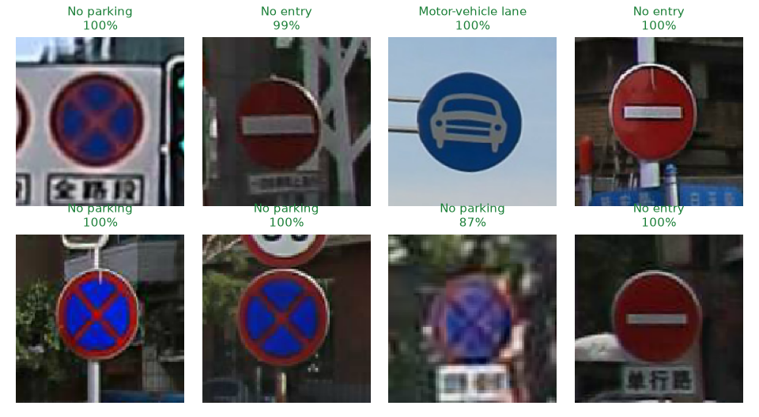
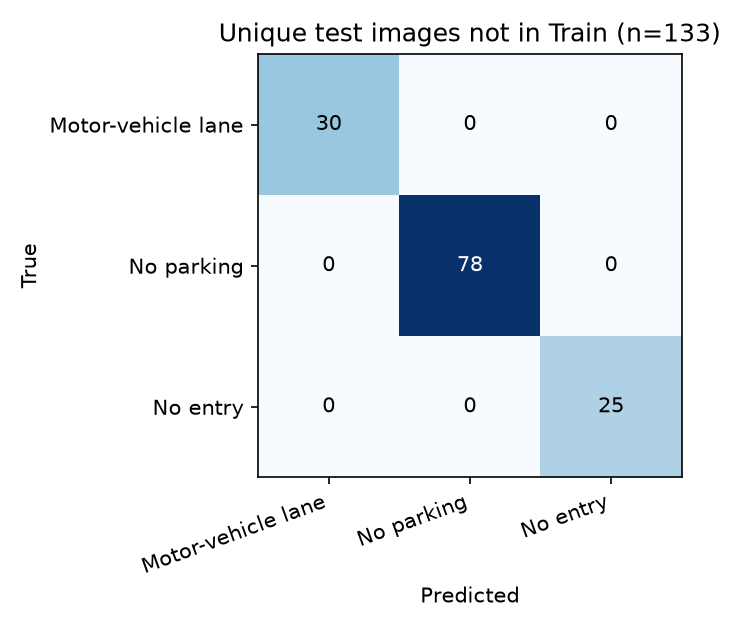

# Real-Time Traffic Sign Recognition (CNN + OpenCV)

> 🇪🇸 Reconocimiento de señales de tránsito en tiempo real con una red neuronal convolucional y la cámara web. Proyecto académico, Universidad Distrital (2023).

A TensorFlow/Keras CNN that classifies 3 traffic signs and runs on a webcam feed with OpenCV.

**Result: 100 % accuracy on 133 unique test images that do not appear in the training set.** The task is small and the classes look very different from each other, so read the [limitations](#limitations) too.



## How it works

```
webcam ──► ROI crop ──► resize 160×160 ──► CNN (Keras) ──► softmax ──► label (if p ≥ 0.85)
```

**Training** (`modelo.ipynb`, Google Colab)
- Images are resized to 160×160 RGB and normalized.
- The sequential CNN has 5 Conv2D + MaxPooling blocks with 25 % dropout, then Dense(512) with 50 % dropout and a softmax output (439,299 parameters).
- It trains for 32 epochs with Adam and categorical cross-entropy.

**Detection** (`Detector.py`)
- OpenCV captures the webcam and draws a region of interest on screen.
- Press **`s`** to classify the region. The label is drawn over the video.
- Predictions below **85 % confidence** are ignored.

## Data

Street photos of 3 Chinese road signs. The file names suggest the Chinese Traffic Sign Recognition Database (TSRD), but the original notebook does not record the source.

| Class | Folder | Train files (unique) | Test files (unique) |
|---|---|---|---|
| Motor-vehicle lane | `Primera` | 446 (70) | 68 (31) |
| No parking | `Segunda` | 324 (113) | 176 (86) |
| No entry | `Tercera` | 162 (66) | 58 (26) |
| **Total** | | **932 (249)** | **302 (143)** |

Many files are byte-identical copies, and 10 unique test images also appear in `Train/`. That is why the results below report each view separately.

## Results

`evaluate.py` runs the committed `modelo.h5` on `Test/`, without retraining:

| View | Images | Accuracy | Classified at ≥ 85 % confidence |
|---|---|---|---|
| All test files | 302 | 100 % | 98.7 % |
| Unique images | 143 | 100 % | 98.6 % |
| **Unique and not in `Train/`** | **133** | **100 %** | **98.5 %** |



Reproduce it (about a minute on a CPU):

```bash
python evaluate.py . docs
```

## Limitations

- **Small and easy task:** 3 classes with very different colors and shapes. This result says nothing about a full traffic sign set.
- **Not measured on the webcam:** these are cropped street photos. Live accuracy depends on lighting, distance and camera, and has not been measured.
- **No validation split in training:** early stopping and checkpointing are set up in the notebook, but they never activated because they monitor `val_loss`.
- **Possible similar shots:** exact duplicates are removed from the strict view, but similar photos of the same sign may remain.
- **Classifier, not detector:** the sign must be placed inside the on-screen rectangle.

## Run it locally

Tested with Python 3.13 on Windows. `Detector.py` needs a webcam.

```bash
pip install -r requirements.txt
python Detector.py
```

Place the sign inside the blue rectangle and press `s`. Press `Esc` to quit.

## Next steps

- Add a validation split so early stopping works.
- Retrain on a public benchmark such as GTSRB or the full TSRD.
- Measure accuracy on a labeled webcam session and add a demo GIF.

## Tech

Python · TensorFlow/Keras · OpenCV · NumPy · scikit-learn · Google Colab

---
Author: **Juan Diego Murillo** · [LinkedIn](https://www.linkedin.com/in/juandiegomurillo) · 2023
